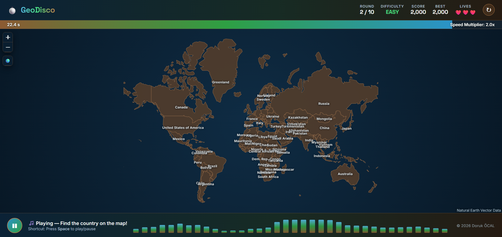

# 🪩 GeoDisco — Global Music & Spatial Discovery GeoGame

**Course:** GMT 458 – Web GIS (Assignment 2: GeoGame)  
**Author:** <a href="https://github.com/dorukocal13">Doruk ÖCAL</a>  
**Live Application (GitHub Pages):** <a href="https://dorukocal13.github.io/GeoDisco/">https://dorukocal13.github.io/GeoDisco/</a>  
**Repository:** <a href="https://github.com/dorukocal13/GeoDisco">https://github.com/dorukocal13/GeoDisco</a>

---

## 1. Game Description & Functional Requirements

**GeoDisco** is an interactive, browser-based GeoGame that combines global musical heritage with spatial reasoning. In each round, the player listens to a 30-second audio preview of a randomly retrieved song from a specific country—spanning multiple eras from 1960s classics to contemporary releases—and must locate its country of origin on an interactive vector world map within **25.0 seconds**.

### Functional Requirements
1. **Single-Piece Vector World Map with Zoom-Adaptive Labels:** Renders country boundaries as interactive Natural Earth vector polygons on a centered full-world projection (excluding Antarctica), featuring mainland-anchored country name labels that progressively reveal smaller nations upon zooming and a one-click reset view control (`🌍`).
2. **Two-Tier Multi-Era Track Retrieval:** Queries open music databases at runtime using confidence-filtered, difficulty-scaled artist pools alongside a deduplicated single-country-of-origin fallback roster to guarantee diverse and geographically accurate tracks every session.
3. **Geodesic Spatial Evaluation:** Calculates the Haversine (Great Circle) distance in kilometers between the player's clicked coordinates and the target country, drawing a dashed geodesic polyline and distance label on the map while awarding proximity points within a **1,700 km** tolerance.
4. **Progressive Temporal Hints:** Dynamically reveals genre/release year metadata and highlights the target continent in blue on the map as the countdown timer runs low.
5. **Live Audio Spectrum & Post-Game Analytics:** Displays a real-time D3.js frequency visualizer during playback and generates a multi-axis Chart.js performance report at the end of the session.
6. **Persistent High-Score Storage & Quick Reset:** Saves the player's all-time best score in `localStorage` and provides an instant HUD restart button (`↻`) with session race-condition protection.

---

## 2. Frontend Layout & Application Interface

The user interface is structured into four distinct functional zones: a top Heads-Up Display (HUD), a full-width countdown progress bar, a central full-bleed Leaflet vector map canvas with floating overlays, and a bottom audio control dock.

---

## 3. Game Mechanics & Progression

### Number of Questions / Tasks
* Each complete session consists of **10 rounds** (`TOTAL_ROUNDS = 10`).
* Countries are drawn without replacement during a session (`usedCountryCodes` set) so no country is repeated within the same game.

### Difficulty Progression
The 36-country dataset (`data/countries_pool.json`) is stratified into three difficulty tiers that scale both geographic obscurity and MusicBrainz artist search depth as rounds advance:
* **Rounds 1–3 (`Easy`):** Major global music hubs and highly distinctive musical traditions (e.g., *Türkiye, Brazil, India, Japan, United Kingdom, United States, Spain, Italy*). Queries the top **100** community-tagged artists per country.
* **Rounds 4–7 (`Medium`):** Regional genres requiring sharper geographic differentiation (e.g., *Argentina, Greece, Nigeria, Jamaica, Ireland, Egypt, Colombia, Portugal*). Expands search depth to the top **300** tagged artists.
* **Rounds 8–10 (`Hard`):** Specialized local styles, micro-regions, and traditional instrumentation (e.g., *Mali, Mongolia, Georgia, Iceland, Senegal, Ethiopia, Azerbaijan, Peru*). Expands search depth to the top **500** tagged artists (automatically falling back to the top 100 for smaller nations with fewer indexed pages).

### Number of Lives
* Players start each game with **3 lives (`❤️❤️❤️`)**.
* Selecting a country farther than **1,700 km** from the target country or letting the 25-second timer expire deducts **1 life**.
* The game concludes either after completing **Round 10** or immediately if lives drop to **0**.

### Scoring & High-Score Mechanism
* **Exact Country Match:** Awards `Math.round(1000 × Speed Multiplier)` points (up to **2,000 points** per round).
* **Spatial Proximity Tolerance (`≤ 1,700 km`):** If the player clicks a neighboring or nearby country within 1,700 km of the target coordinates, **no life is lost**, and partial proximity points are awarded based on inverse distance:
  `Points = Math.max(100, Math.round(500 × (1 - distanceKm / 1700)))`
* **High-Score Persistence:** Whenever the current score exceeds the stored record, it is saved to `localStorage` under the key `geodisco_highscore_v1` and displayed in the top HUD.

---

## 4. Temporal Component

Time directly governs both scoring potential and spatial assistance during every round:
1. **25.0-Second Countdown:** Each round begins with a strict 25.0-second timer updated every `100 ms`.
2. **Speed Multiplier Decay:**
   * **0.0 – 5.0 seconds elapsed (`≥ 20.0s` remaining):** Maximum `2.0x` multiplier.
   * **5.1 – 25.0 seconds elapsed (`< 20.0s` remaining):** Scales linearly via `1.0 + (remainingSeconds / 20)` down to `1.0x`.
   * **Hint Penalty:** Activating a progressive hint applies a `-0.2x` adjustment (floored at `1.0x`).
3. **Time-Triggered Progressive Hints:**
   * **At 15.0 seconds remaining (10s elapsed):** The hint panel unlocks, displaying the track's **genre** and **release year**.
   * **At 8.0 seconds remaining (17s elapsed):** A spatial hint triggers on the Leaflet map, highlighting all countries belonging to the target country's **continent** in **blue** (preserved across hover interactions).

---

## 5. JavaScript Libraries & Open Datasets

### JavaScript Libraries
* **<a href="https://leafletjs.com/">Leaflet.js (`v1.9.4`)</a>:** Renders the single-piece vector world map without external tile dependencies, mainland-anchored zoom-adaptive country name labels, hover/hint continent styles, geodesic feedback polylines, and distance tooltips.
* **<a href="https://d3js.org/">D3.js (`v7`)</a>:** Drives the SVG-based 36-bar live frequency spectrum visualizer in the bottom audio dock using `requestAnimationFrame` harmonic wave interpolation.
* **<a href="https://www.chartjs.org/">Chart.js (`v4.4.1`)</a>:** Renders a dual-axis bar and line chart in the post-game summary modal, visualizing points earned per round (color-coded by accuracy) alongside response time in seconds.

### Openly Available Datasets
* **<a href="https://www.naturalearthdata.com/">Natural Earth (`ne_110m_admin_0_countries.geojson`)</a>:** Public-domain vector boundary dataset loaded via multi-source fallback (local `./data/countries.geojson`, jsDelivr CDN, and GitHub Raw) providing country polygons, `ISO_A3` codes, and `CONTINENT` classifications.
* **<a href="https://musicbrainz.org/doc/MusicBrainz_API">MusicBrainz Open Web Service (`WS/2`)</a>:** Open-source music encyclopedia API queried by ISO-3166 country codes (`country:TR AND tag:*`) with `1.1s` rate-limit compliance, minimum confidence filtering (`score >= 90`), nationality disambiguation validation, and difficulty-scaled `offset` parameters.
* **<a href="https://developer.apple.com/library/archive/documentation/AudioVideo/Conceptual/iTuneSearchAPI/">iTunes Search API</a>:** Public media endpoint used to retrieve 30-second HTTPS audio previews (`previewUrl`), release dates (`releaseDate`), and primary genres (`primaryGenreName`), backed by a curated, single-country-of-origin multi-era fallback roster.

---

## 6. Technical Implementation Details

### Three Event Handlers Implemented
1. **Map Polygon & UI Button `click` Event Handlers (`js/mapManager.js` & `js/main.js`):**
   * `layer.on('click', ...)` captures user clicks on individual country GeoJSON features, extracts the country's ISO code and click coordinates, and passes them to the game engine for Haversine distance evaluation.
   * Button `click` listeners (`startGameBtn`, `restartGameBtn`, `hudRestartBtn`, `playPauseBtn`, `nextRoundBtn`, and the custom Leaflet `🌍` reset control) manage game state transitions, view resets, and audio playback.
2. **Keyboard `keydown` Event Handler (`js/main.js`):**
   * Attached to `document`, this listener intercepts the `Space` key (`event.code === 'Space'`) during active gameplay to toggle audio playback (`play`/`pause`) without forcing the player to move their cursor away from the map.
3. **HTML5 Audio Media Event Handlers (`playing`, `pause`, `ended`, `error` in `js/main.js`):**
   * Synchronizes the `<audio>` element's playback lifecycle with the UI button icon (`▶` / `❚❚`), starts the round timer upon audio playback, controls the D3.js spectrum animation loop, and automatically retries alternative streams on playback errors.

### Use of Closures (`js/gameEngine.js`)
The game state engine is implemented via a factory function `createGameEngine(countriesPool)` that uses **JavaScript closures** to encapsulate sensitive state variables (`currentRound`, `score`, `highScore`, `lives`, `difficulty`, `usedCountryCodes`, `activeCountry`, `activeTrack`, `roundHistory`) inside its private lexical scope. External modules cannot directly overwrite `score` or `lives` via the global scope or browser console; they can only interact with the state through privileged public methods (`resetGame`, `pickNextCountry`, `activateRound`, `getMultiplierPreview`, `evaluateGuess`, `handleTimeout`, `getSummaryStats`, `getState`).

### Interaction with the DOM (`js/main.js` & `js/mapManager.js`)
The application continuously updates the Document Object Model in response to gameplay events:
* **HUD & Badge Updates:** Dynamically mutates `textContent` and CSS utility classes (`badge-easy`, `badge-medium`, `badge-hard`) on `#round-display`, `#score-display`, `#highscore-display`, `#difficulty-display`, and `#lives-display`.
* **Real-Time Timer Animation:** Adjusts `#timer-bar` width (`element.style.width`) and background gradient every 100 ms while updating `#timer-text` and `#multiplier-text`.
* **Conditional Overlays & Dynamic Labels:** Toggles visibility via `classList.add('hidden')` and `classList.remove('hidden')` for the hover country tooltip, progressive hint box, round feedback card, and end-game analytics modal, while dynamically adding/removing `L.divIcon` country labels based on zoom level.

---

## 7. Project Directory Structure

    GeoDisco/
    ├── index.html                 # Main layout, HUD, audio dock, and start/end modals
    ├── css/
    │   └── style.css              # Ocean/earth theme styling, responsive layout & map labels
    ├── js/
    │   ├── main.js                # Event handlers, timer loop, session guard & DOM orchestration
    │   ├── gameEngine.js          # Closure-based state engine & Haversine distance math
    │   ├── mapManager.js          # Leaflet map setup, GeoJSON styling, labels & geodesic lines
    │   ├── apiService.js          # MusicBrainz + iTunes two-tier random track loader
    │   └── audioVisualizer.js     # D3.js live spectrum & Chart.js end-game analytics
    ├── data/
    │   ├── countries.geojson      # Local Natural Earth 110m vector boundaries fallback
    │   └── countries_pool.json    # 36-country difficulty pool with coordinates & ISO codes
    ├── docs/
    │   └── screenshot.png         # Gameplay interface screenshot
    └── README.md                  # Project design and technical documentation

---

## 8. AI Assistance & Learning Reflection

During the development of **GeoDisco**, **Google Gemini** was utilized as a collaborative technical mentor throughout the design and implementation phases. Key takeaways and learning outcomes from this interaction include:
* **Two-Tier API Pipeline & Data Hygiene:** Learned how to chain **MusicBrainz** (using `tag:*` filters, nationality disambiguation checks, and difficulty-scaled `offset` pagination) with the **iTunes Search API**, backed by a deduplicated single-country-of-origin roster to prevent misattributions and ensure zero-downtime playback.
* **Spatial Math & Cartographic Labeling:** Applied the **Haversine formula** to evaluate a **1,700 km** proximity tolerance, and computed largest-polygon bounding centroids so multi-polygon countries render zoom-adaptive labels accurately over their mainlands.
* **State Encapsulation & Modular ES6:** Strengthened understanding of **JavaScript closures** and session ID guards (`roundSessionId`) for protecting game state integrity across asynchronous network calls and modular ES6 files (`MapManager`, `AudioVisualizer`, `createGameEngine`).
* **Multi-Library Integration:** Combined **Leaflet.js**, **D3.js**, and **Chart.js** cohesively within a single responsive WebGIS interface.

* **AI Conversation URL:** <a href="https://share.gemini.google/Lx6w7KrCldUC">https://share.gemini.google/Lx6w7KrCldUC</a>

---

© 2026 Doruk ÖCAL. All rights reserved.